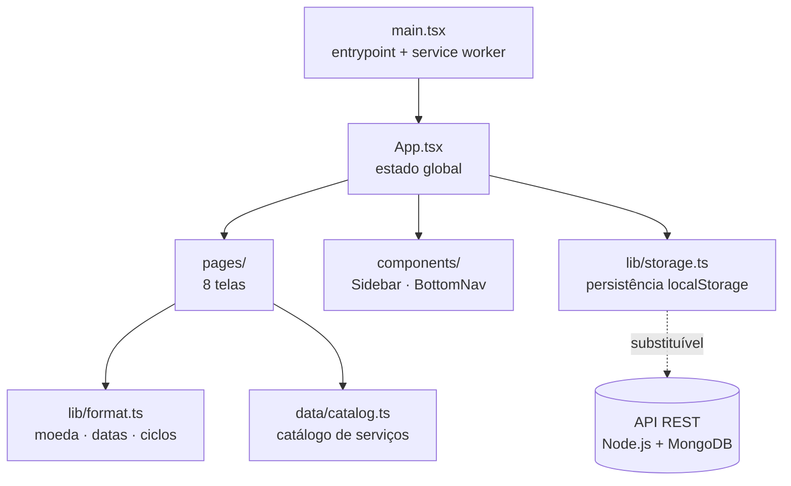

# 💸 GastoZero

> **Controle e conscientização financeira de gastos recorrentes e serviços por assinatura.**

Projeto Integrador — Sistemas de Informação
Aplicação Web Progressiva (PWA)


---

## 📌 O problema

Assinaturas são cobranças pequenas, automáticas e fáceis de esquecer. Somadas,
viram um rombo silencioso no orçamento: R$ 20 aqui, R$ 60 ali — e no fim do ano
o valor passa de mil reais sem que a pessoa perceba.

Os apps de finanças tradicionais exigem cadastro manual de cada despesa, o que
faz a maioria dos usuários desistir na primeira semana.

## 💡 A solução

O **GastoZero** elimina a burocracia do cadastro manual. A aplicação já vem com
um **catálogo global de serviços e planos com preços embutidos**: o usuário só
escolhe o serviço e o plano que usa, e o sistema faz o resto — calcula o impacto
mensal e anual, gera gráficos por categoria, avisa antes das cobranças e permite
simular quanto economizaria ao cancelar ou pausar cada assinatura.

---

## ✨ Funcionalidades

| Funcionalidade | Descrição |
| --- | --- |
| 🗂️ **Catálogo inteligente** | 21 serviços pré-cadastrados (Netflix, Spotify, iCloud+, academia, plano de celular…) com planos e preços. O valor é preenchido automaticamente ao selecionar o plano. |
| 🧮 **Cálculo automático** | Impacto mensal e projeção anual atualizados em tempo real. Planos anuais são normalizados para custo mensal equivalente. |
| 🔔 **Alertas de cobrança** | Vencimentos agrupados por urgência (hoje, 3 dias, 14 dias, futuras), com datas calculadas dinamicamente e renovação automática de ciclo. |
| 📊 **Dashboard analítico** | Gráfico de rosca por categoria e gráfico de barras com a projeção acumulada dos próximos 12 meses. |
| 💰 **Simulador de economia** | Marque assinaturas candidatas a cancelamento e veja economia mensal, anual e o percentual de redução no orçamento. |
| ⏸️ **Gestão de assinaturas** | Pausar, retomar e cancelar serviços, com busca e filtros por categoria. |
| 📱 **Experiência PWA** | Instalável no celular como app nativo, com service worker e funcionamento offline — sem passar por loja de aplicativos. |

---

## 🖥️ Telas

| Tela | O que mostra |
| --- | --- |
| **Login / Cadastro** | Autenticação com validação de formulário |
| **Visão Geral** | Indicadores, gráficos e próximas cobranças |
| **Minhas Assinaturas** | Lista gerenciável com busca e filtros |
| **Catálogo** | Serviços e planos com preços prontos |
| **Simulador** | Comparativo "antes x depois" da economia |
| **Alertas** | Cobranças agrupadas por urgência |
| **Configurações** | Perfil, notificações e conta |

---

## 🏗️ Arquitetura



O estado das assinaturas é **persistido e derivado**: guarda-se o dado puro
(`StoredSubscription`), e campos como `daysUntil`, custo mensal normalizado e
data formatada são calculados na renderização por `enrichSubscription()`. Isso
mantém uma fonte de verdade única e já deixa o formato pronto para serialização
em uma API REST.

---

## 🧰 Tecnologias

| Camada | Tecnologia | Finalidade |
| --- | --- | --- |
| Frontend / PWA | **React 19 + Vite 8 + Service Worker** | Interface componentizada, responsiva e instalável |
| Linguagem | **TypeScript 5.9** | Tipagem estática do domínio (`src/types.ts`) |
| Estilização | **Tailwind CSS v4** | Design system utilitário, mobile-first |
| Visualização de dados | **Recharts** | Gráficos de categorias e projeções |
| Ícones | **lucide-react** | Iconografia consistente |
| Persistência (atual) | **localStorage** | Camada de dados local até a API existir |
| Persistência (planejada) | **Node.js + MongoDB** | API REST para autenticação e regras de negócio |

---

## 🚀 Como executar

**Requisitos:** Node.js 20 ou superior.

```bash
# 1. Instalar dependências
npm install

# 2. Criar o .env na raiz com MONGODB_URI, JWT_SECRET e PORT=3001

# 3. Rodar front (5173) + API (3001) juntos, a partir da raiz do projeto
npm run dev:all
```

> ℹ️ Se a API falhar com `querySrv ECONNREFUSED` ao conectar no MongoDB Atlas,
> o Node não está achando o DNS da rede. O servidor já tenta DNS públicos
> automaticamente; para usar outros, defina `DNS_SERVERS=8.8.8.8,1.1.1.1` no `.env`.

Outros comandos:

```bash
npm run typecheck    # checagem de tipos (TypeScript)
npm run build        # typecheck + build de produção em dist/
npm run preview      # serve o build — necessário para testar o PWA
```

> ℹ️ O service worker só é registrado no build de produção. Para instalar o app
> no celular ou testar o modo offline, use `npm run build` seguido de
> `npm run preview`.

### 🔑 Acesso de demonstração

| Campo | Valor |
| --- | --- |
| E-mail | `admin@email.com` |
| Senha | `admin123` |

Credenciais definidas em `src/pages/Login.tsx` enquanto não há backend de
autenticação.

### 🛡️ Painel do administrador

Não existe botão de "entrar como admin": o login é o mesmo, e o que diferencia é
o e-mail, que no banco tem `role: "admin"`. Para criar o primeiro administrador:

```bash
npm run create-admin -- admin@gastozero.com minhaSenha123 "Nome do Admin"
```

Se o e-mail já existir, a conta é promovida a admin e recebe a nova senha. Depois
disso, um admin cadastra outros pela tela **Administradores**. O painel tem:

- **Usuários**: lista dos usuários padrão com as assinaturas de cada um
- **Relatórios**: gráficos gerais (gasto por categoria, serviços mais assinados) com exportação em CSV e PDF
- **Administradores**: lista e cadastro de contas de admin

---

## 📁 Estrutura do projeto

```
GastoZero/
├── index.html                  # shell HTML com metadados e manifest
├── vite.config.ts              # React + Tailwind v4 + alias @
├── public/
│   ├── manifest.webmanifest    # metadados de instalação do PWA
│   ├── sw.js                   # service worker (cache offline)
│   └── icons/icon.svg          # ícone do app
└── src/
    ├── main.tsx                # entrypoint e registro do service worker
    ├── App.tsx                 # estado global e navegação
    ├── types.ts                # tipos do domínio
    ├── data/catalog.ts         # catálogo global de serviços e planos
    ├── lib/
    │   ├── format.ts           # moeda, datas, ciclos e campos derivados
    │   └── storage.ts          # persistência em localStorage
    ├── components/
    │   ├── Sidebar.tsx         # navegação desktop
    │   └── BottomNav.tsx       # navegação mobile
    └── pages/                  # Login, Register, Dashboard, Subscriptions,
                                # Catalog, Simulator, Alerts, Settings
```

---

## 🗄️ Dados

Os dados são salvos no `localStorage` do navegador com o prefixo `gastozero:`
(assinaturas, perfil e sessão). Sair da conta em **Configurações** limpa esses
dados e restaura o conjunto de demonstração.

Os preços de `src/data/catalog.ts` são valores de referência em BRL e devem ser
ajustados conforme as tabelas oficiais vigentes de cada serviço.

---

## 🛣️ Próximos passos

- [ ] API REST em Node.js (Express ou Fastify) para autenticação e regras de negócio
- [ ] Persistência em MongoDB (usuários, assinaturas e catálogo global)
- [ ] Autenticação real com JWT e hash de senha
- [ ] Notificações push para os alertas de cobrança
- [ ] Painel administrativo para manutenção do catálogo de preços

> A migração para a API é direta: o formato `StoredSubscription` já é
> serializável, bastando substituir `usePersistentState` em `src/App.tsx` por
> chamadas HTTP.
